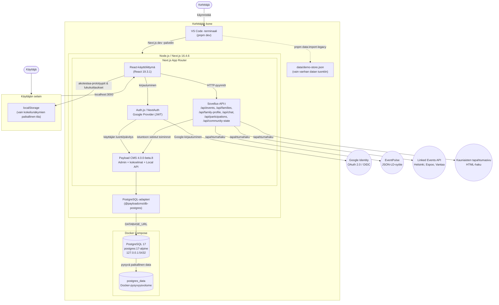
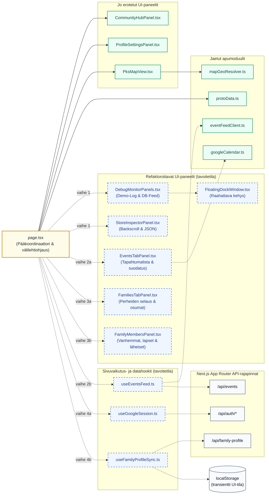

# Junailijat – Sovellus- ja moduuliarkkitehtuuri

Tämä dokumentti esittää GitHubissa suoraan renderöityvät Mermaid-näkymät projektin paikallisesta kehitysympäristöstä ja `shellproto`-moduulirakenteesta. Tarkemmat Architecture-as-Code-lähteet sijaitsevat tiedostoissa [`docs/arkkitehtuuri_localhost.puml`](./arkkitehtuuri_localhost.puml) ja [`docs/arkkitehtuuri_shellproto.puml`](./arkkitehtuuri_shellproto.puml).

---

## 1. Paikallinen kehitysympäristö (localhost)

---

## 2. Shellproto-komponentti- ja moduuliarkkitehtuuri

Vihreät moduulit on jo eriytetty omiin tiedostoihinsa; siniset ovat refaktoroinnin vaiheittainen työlista (`vaihe 1` → `vaihe 4b`).

