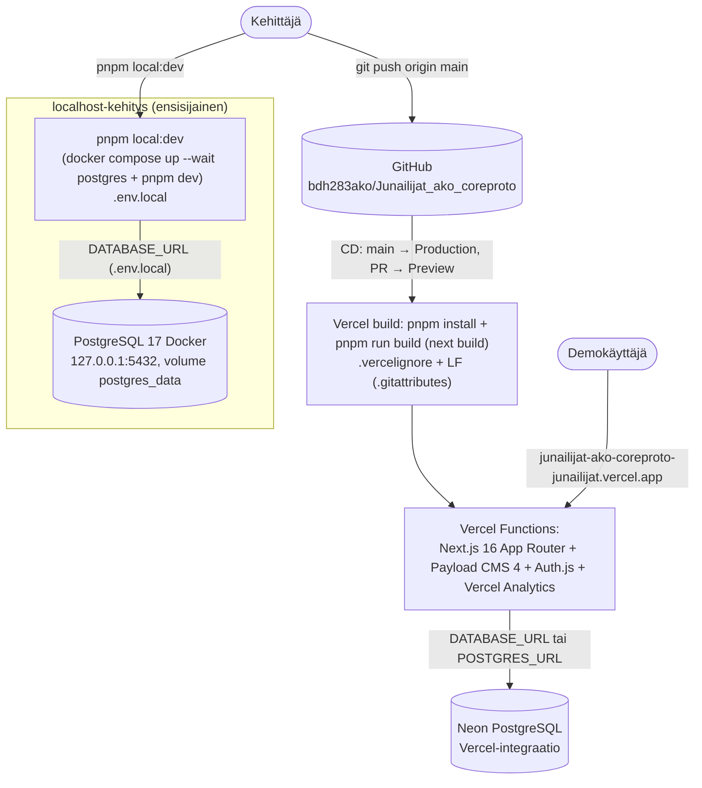
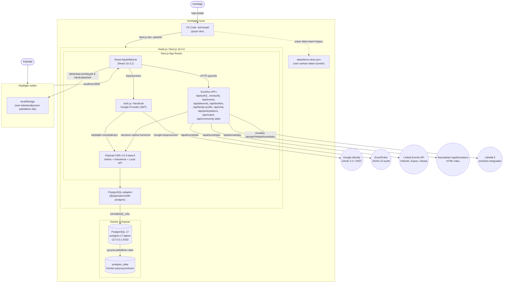

# Junailijat – Sovellus- ja moduuliarkkitehtuuri

Tämä dokumentti esittää GitHubissa suoraan renderöityvät Mermaid-näkymät projektin **käyttöympäristöistä** (Vercel-demo + paikallinen localhost), paikallisesta kehitysympäristöstä ja `shellproto`-moduulirakenteesta. Tarkemmat Architecture-as-Code-lähteet sijaitsevat tiedostoissa [`docs/arkkitehtuuri_vercel.puml`](./arkkitehtuuri_vercel.puml), [`docs/arkkitehtuuri_localhost.puml`](./arkkitehtuuri_localhost.puml) ja [`docs/arkkitehtuuri_shellproto.puml`](./arkkitehtuuri_shellproto.puml).

---

## 1. Käyttöympäristöt: Vercel-demo (tuotanto) vs localhost-kehitys

Varsinainen demoinstanssi pyörii **Vercelillä** (projekti `junailijat-ako-coreproto`): https://junailijat-ako-coreproto-junailijat.vercel.app — deploy tapahtuu CD-putkella GitHubista (`git push origin main` → Production; PR → Preview). Paikallinen kehitys (`pnpm local:dev`) on ensisijainen devauspaikka; CD-putki hoitaa deploymentin Verceliin.



### Ympäristömuuttujien kerrokset

| Muuttuja | localhost-dev | Vercel (Production / Preview / Development) |
| --- | --- | --- |
| `DATABASE_URL` | `.env.local` → Docker PostgreSQL `127.0.0.1:5432` | Vercel env (Neon-integraatio) |
| `POSTGRES_URL` | ei käytössä paikallisesti | Vercel env (Neon); koodi lukee `process.env.DATABASE_URL \|\| process.env.POSTGRES_URL` (`src/payload.config.ts`) |
| `PAYLOAD_SECRET`, `AUTH_SECRET`, `AUTH_GOOGLE_ID`, `AUTH_GOOGLE_SECRET` | `.env.local` (gitignoretty) | Vercel Secret -muuttujat, ei commitoida |
| `NEXT_PUBLIC_SITE_URL` | `http://localhost:3000` | Vercelin tuotanto/preview-URL |

- **Tietokannat ovat eri instansseja**: paikallinen Docker-PG ei ole sama kuin Vercelin Neon. Payload ajaa `push: false` -tilassa, joten skeemamigraatiot Vercelin tietokantaan ajetaan tarkoituksella erikseen (`payload migrate` oikeilla env-muuttujilla) — build ei muuta skeemaa.
- **Deploy-säännöt:** älä käytä `vercel --prod` -CLI:ta Windows-koneelta (CRLF-rivinvaihdot rikkovat buildin: `ELIFECYCLE -2` / `BUILD_UTILS_SPAWN_254`); `.gitattributes` (`* text=auto eol=lf`) pitää LF-muodon ja CD-putki (git push) on ensisijainen tapa. `.vercelignore` estää `.env.*`, `*.ps1`, `node_modules`, `.next` ym. päätymisen deployiin.
- PlantUML-lähde Vercel-näkymälle: [`docs/arkkitehtuuri_vercel.puml`](./arkkitehtuuri_vercel.puml).

---

## 2. Paikallinen kehitysympäristö (localhost)



---

## 3. Shellproto-komponentti- ja moduuliarkkitehtuuri

Vihreät moduulit on eriytetty omiin tiedostoihinsa; kaikki suunnitellut paneeli- ja hook-erottelut on toteutettu.

```mermaid
flowchart LR
    classDef coordinator fill:#fefce8,stroke:#ca8a04,stroke-width:2px,color:#1e293b
    classDef extracted fill:#ecfdf5,stroke:#059669,stroke-width:1.5px,color:#064e3b
    classDef api fill:#f8fafc,stroke:#64748b,stroke-width:1.5px,color:#0f172a

    Page["page.tsx<br/>(Pääkoordinaattori & välilehtiohjaus)"]:::coordinator

    subgraph ExtractedPanels["Jo erotetut UI-paneelit"]
        HubPanel["CommunityHubPanel.tsx"]:::extracted
        ProfilePanel["ProfileSettingsPanel.tsx"]:::extracted
        MapView["PksMapView.tsx<br/>(Kartta, perhe-/tapahtumafeed)"]:::extracted
        DockWindow["FloatingDockWindow.tsx<br/>(Raahattava kehys)"]:::extracted
        DebugPanels["DebugMonitorPanels.tsx<br/>(Demo-Log & DB-Feed)"]:::extracted
        InspectorPanel["StoreInspectorPanel.tsx<br/>(Backscroll & JSON)"]:::extracted
        EventsPanel["EventsTabPanel.tsx<br/>(Tapahtumalista & suodatus)"]:::extracted
        FamiliesPanel["FamiliesTabPanel.tsx<br/>(Perheiden selaus & osumat)"]:::extracted
        MembersPanel["FamilyMembersPanel.tsx<br/>(Vanhemmat, lapset & läheiset)"]:::extracted
        EventChatWindow["EventChatWindow.tsx<br/>(Kelluva tapahtumachat)"]:::extracted
        EventCard["EventCard.tsx"]:::extracted
        MapPinLayer["MapPinLayer.tsx"]:::extracted
    end

    subgraph ExtractedHooks["Jo erotetut hookit"]
        HookSession["useGoogleSession.ts"]:::extracted
        HookEvents["useEventsFeed.ts"]:::extracted
        HookProfileSync["useFamilyProfileSync.ts"]:::extracted
        HookEventChat["hooks/useEventChatAndParticipations.ts"]:::extracted
    end

    subgraph Helpers["Jaetut apumoduulit"]
        ProtoData["protoData.ts"]:::extracted
        FeedClient["eventFeedClient.ts"]:::extracted
        GeoResolver["mapGeoResolver.ts"]:::extracted
        GCalHelper["googleCalendar.ts"]:::extracted
        PksAreas["pksAreas.ts"]:::extracted
    end

    subgraph ExternalDeps["Ulkoiset riippuvuudet"]
        EnrollmentFlow["useEnrollmentFlow"]:::extracted
        EnrollmentModal["FamilyEnrollmentModal"]:::extracted
    end

    subgraph ApiLayer["Next.js App Router API-rajapinnat"]
        ApiAuth["/api/auth/[...nextauth]"]:::api
        ApiEvents["/api/events"]:::api
        ApiAllEvents["/api/allevents"]:::api
        ApiProfile["/api/family-profile"]:::api
        ApiFamilies["/api/families"]:::api
        ApiChat["/api/chat"]:::api
        ApiParticipations["/api/participations"]:::api
        ApiMatch["/api/match"]:::api
        ApiCommunityState["/api/community-state"]:::api
    end

    LocalStorage[("localStorage<br/>(transientti UI-tila)")]:::api

    Page --> HubPanel
    Page --> ProfilePanel
    Page -->|tapahtuma- ja osallistumiskäsittelijät| MapView
    Page --> ProtoData

    Page --> DebugPanels
    Page --> InspectorPanel
    Page --> EventsPanel
    Page --> FamiliesPanel
    Page --> MembersPanel

    DebugPanels --> DockWindow : käyttää kehystä
    EventChatWindow --> DockWindow : käyttää kehystä

    Page --> HookSession
    Page --> HookEvents
    Page --> HookProfileSync
    Page --> HookEventChat

    EventsPanel --> GCalHelper
    MapView --> GCalHelper
    MapView --> GeoResolver
    MapView --> MapPinLayer
    MapView --> PksAreas
    HookEvents --> FeedClient
    HookEventChat --> ApiChat
    HookEventChat --> ApiParticipations

    Page --> EnrollmentFlow
    Page --> EnrollmentModal

    HookSession --> ApiAuth : GET session / POST signin & signout
    HookEvents --> ApiEvents : GET /api/events
    HookProfileSync --> ApiProfile : GET & PUT /api/family-profile
    HookProfileSync --> LocalStorage : transientti UI-tila\n(ei PII-dataa)
```